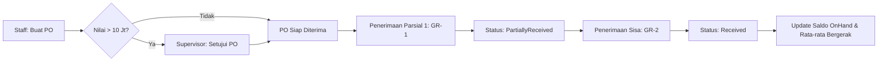
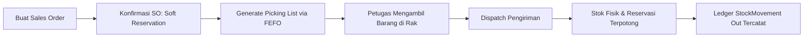

# Panduan Deployment, Operasional, dan Pemeliharaan Sistem WMS

Dokumen ini adalah panduan referensi resmi untuk instalasi, konfigurasi environment, seed data, manajemen role/RBAC, alur kerja operasional, batasan teknis, serta deployment ke Supabase PostgreSQL dan strategi backup.

---

## 1. Instalasi dan Persyaratan Lingkungan (Environment Prerequisites)

### 1.1 Persyaratan Sistem
- **Runtime & SDK**: .NET 8.0 SDK (LTS) — versi `8.0.415` atau lebih baru.
- **Database**: PostgreSQL 15/16 (Lokal atau Supabase Cloud).
- **Tools Tambahan**:
  - `dotnet-ef` CLI tool: `dotnet tool install --global dotnet-ef`
  - Git CLI
  - (Opsional) Docker Desktop / Engine untuk pengujian lokal Testcontainers.

### 1.2 Langkah Instalasi Lokal
1. **Clone repositori**:
   ```bash
   git clone <repo_url>
   cd WMS
   ```

2. **Setup File Konfigurasi Environment**:
   Salin template `.env.example` menjadi `.env.local` atau `.env`:
   ```bash
   cp .env.example .env.local
   ```
   Atau salin konfigurasi ASP.NET Core:
   ```bash
   cp src/Wms.Web/appsettings.json src/Wms.Web/appsettings.Development.json
   ```

3. **Restore & Build Solution**:
   ```bash
   dotnet restore
   dotnet build --no-restore -warnaserror
   ```

4. **Jalankan Database Migration & Seed**:
   ```bash
   cd src/Wms.Web
   dotnet ef database update --project ../Wms.Infrastructure
   ```

5. **Jalankan Aplikasi Web (Blazor Server)**:
   ```bash
   dotnet run --project src/Wms.Web
   ```
   Aplikasi akan berjalan di `http://localhost:5000` (atau port yang ditentukan pada `launchSettings.json`).

---

## 2. Kamus Variabel Lingkungan (Environment Variables Dictionary)

Sistem membaca konfigurasi dari kombinasi `appsettings.json`, environment variables sistem, dan `.env` (via standard .NET configuration providers):

| Nama Variabel | Wajib | Nilai Contoh / Default | Deskripsi |
|---|---|---|---|
| `ASPNETCORE_ENVIRONMENT` | Ya | `Development` / `Production` | Mengontrol mode runtime, developer exception page, dan logging |
| `ConnectionStrings__DefaultConnection` | Ya | `Host=...;Port=5432;Database=postgres;Username=postgres;Password=...;SSL Mode=Require;Trust Server Certificate=true;` | Connection string PostgreSQL utama (Format Npgsql) |
| `SUPABASE_URL` | Opsional | `https://xxxx.supabase.co` | URL project Supabase API (jika terintegrasi dengan storage/auth eksternal) |
| `SUPABASE_ANON_KEY` | Opsional | `sb_publishable_...` | API Key publik Supabase |
| `Database__EnableAutoSeed` | Tidak | `true` (Dev) / `false` (Prod) | Menjalankan DatabaseSeeder otomatis jika database kosong saat startup |
| `Serilog__MinimumLevel__Default` | Tidak | `Information` (Prod) / `Debug` (Dev) | Level logging minimum serilog |

### Format Connection String PostgreSQL / Supabase
- **Direct Connection / Session Pooler (Port 5432) — Direkomendasikan untuk WMS**:
  ```
  Host=db.<project-ref>.supabase.co;Port=5432;Database=postgres;Username=postgres;Password=<DB_PASSWORD>;SSL Mode=Require;Trust Server Certificate=true;Pooling=true;Minimum Pool Size=2;Maximum Pool Size=20;
  ```
- **Transaction Pooler (Port 6543)**:
  Jika menggunakan PgBouncer port 6543, tambahkan `No Reset On Close=true;` pada Npgsql connection string untuk mencegah error prepared statement. *Catatan: EF Core Migrations tidak boleh dijalankan di port 6543.*

---

## 3. Database Seeding & Akun Bawaan (Default Seed Data)

Ketika `DatabaseSeeder` dieksekusi (atau saat inisialisasi awal), sistem menyiapkan data baseline berikut:

### 3.1 Akun Pengguna Bawaan (Default Accounts)
Semua akun bawaan di-generate dengan password standar: `Admin123!` (Wajib diubah di lingkungan produksi).

| Email | Username | Role Utama | Peruntukan & Wewenang |
|---|---|---|---|
| `admin@wms.local` | `admin` | `SuperAdmin` | Akses penuh seluruh sistem, bypass filter gudang, kelola user & role |
| `supervisor@wms.local` | `supervisor` | `Supervisor` | Approval PO (>10 jt), approval selisih stock opname, approval write-off/incident, approval transfer |
| `staff@wms.local` | `staff` | `AdminGudang` | Input barang masuk, buat dokumen pengeluaran, input PO, create opname |
| `auditor@wms.local` | `auditor` | `Auditor` | Akses baca saja (Read-Only) ke audit log, kartu stok, buku besar, dan laporan |

### 3.2 Master Data Bawaan
- **Gudang**: Gudang Pusat Jakarta (`GDG-JKT`), Gudang Distribusi Surabaya (`GDG-SBY`).
- **Lokasi Rak**: Rak Fast-Moving (`LOC-A1`, `LOC-A2`), Rak Pallet Bulk (`LOC-B1`, `LOC-B2`).
- **Kategori Barang**: Elektronik, Aksesoris Komputer, Peralatan Kantor.
- **Satuan**: Pcs (PCS), Box (BOX), Unit (UNT), Karton (CTN).
- **Produk Sampel**: Berbagai SKU dengan tracking method standar dan lot/batch expired FEFO.

---

## 4. Matriks Peran & Hak Akses (Role-Based Access Control / RBAC)

Sistem menggunakan granular permissions berbasis string permission (contoh: `stock.in.create`, `po.approve`).

| Modul & Izin | SuperAdmin | Supervisor | AdminGudang | PetugasGudang | Auditor |
|---|:---:|:---:|:---:|:---:|:---:|
| **Master Data (Warehouse, Product, Category, Unit)** | C, R, U, D | R | C, R, U | R | R |
| **Barang Masuk (Goods Receipt) — Input / Draft** | Ya | Ya | Ya | Ya | Tidak |
| **Barang Masuk (Goods Receipt) — Posting & Reverse** | Ya | Ya | Ya | Tidak | Tidak |
| **Barang Keluar (Stock Out) — Input / Draft** | Ya | Ya | Ya | Ya | Tidak |
| **Barang Keluar (Stock Out) — Posting & Reverse** | Ya | Ya | Ya | Tidak | Tidak |
| **Purchase Order (PO) — Buat & Edit** | Ya | Ya | Ya | Tidak | Tidak |
| **Purchase Order (PO) — Approval** | Ya | Ya | Tidak | Tidak | Tidak |
| **Transfer Gudang — Dispatch (`in_transit`)** | Ya | Ya | Ya | Tidak | Tidak |
| **Transfer Gudang — Approval / Penerimaan** | Ya | Ya | Tidak | Tidak | Tidak |
| **Stock Opname — Mulai & Input Fisik** | Ya | Ya | Ya | Tidak | Tidak |
| **Stock Opname — Approval & Posting Selisih** | Ya | Ya | Tidak | Tidak | Tidak |
| **Kejadian Hilang/Rusak (Stock Incident) — Approval** | Ya | Ya | Tidak | Tidak | Tidak |
| **Laporan & Export (CSV, XLSX, PDF)** | Ya | Ya | Ya | Tidak | Ya |
| **Viewer Audit Log & Rekonsiliasi Saldo** | Ya | Ya | Tidak | Tidak | Ya |
| **Backup Sistem & Restore** | Ya | Tidak | Tidak | Tidak | Tidak |

### Aturan Pemisahan Tugas (Separation of Duties Guard)
- **Anti Self-Approval**: Pembuat dokumen (PO, Stock Opname, Stock Transfer, Stock Incident) **dilarang keras** menyetujui dokumen yang dibuatnya sendiri, bahkan jika ia memiliki role Supervisor.
- **Anti Tampering**: Pemeriksaan sesi dan hak akses dievaluasi di level Application/Domain Service pada backend, bukan hanya di layer Razor UI.

---

## 5. Alur Kerja Operasional Utama (Core Workflows)

### 5.1 Barang Masuk via Purchase Order (PO & Partial Receipt)


### 5.2 Barang Keluar & Sales Order (FEFO Soft Reservation & Picking)


### 5.3 Transfer Antar-Gudang (Tanpa Duplikasi Stok)
1. Gudang Asal membuat dokumen transfer: status `Draft`.
2. Pengiriman barang: stok di lokasi asal dipotong, status dokumen berubah menjadi `in_transit`. Saldo di gudang tujuan **belum** bertambah.
3. Barang tiba di Gudang Tujuan: Supervisor penerima memverifikasi kuantitas fisik dan menekan tombol *Terima Transfer*. Saldo di gudang tujuan bertambah pada lokasi rak yang dialokasikan. Status dokumen menjadi `Received`.
4. *Invarian*: Tidak ada duplikasi saldo selama perjalanan fisik.

### 5.4 Stock Opname & Penyesuaian Saldo
1. **Inisialisasi**: Supervisor/Admin membuat sesi opname pada gudang tertentu -> sistem membuat snapshot saldo sistem saat itu.
2. **Pencatatan Fisik**: Petugas menghitung fisik barang di rak dan menginput hasil hitung.
3. **Rekonsiliasi**: Sistem menghitung varians kuantitas dan varians nilai rupiah berdasarkan harga rata-rata berjalan.
4. **Approval**: Supervisor (bukan pembuat dokumen) menyetujui selisih penyesuaian.
5. **Posting**: Sistem secara otomatis membuat `StockMovement` bertipe `OpnameAdjustment` ke ledger append-only dan menyesuaikan `InventoryBalance`.

### 5.5 Pembatalan / Koreksi Transaksi (Append-Only Reversal)
- Transaksi yang sudah berstatus `Posted` **tidak boleh dihapus atau di-update nilainya**.
- Koreksi dilakukan dengan mekanisme **Reversal**:
  - Sistem memvalidasi apakah sisa stok mencukupi untuk ditarik kembali.
  - Membuat transaksi counter bertaut (`GoodsReceiptReversal` atau `StockOutReversal`) di ledger `StockMovements`.
  - Mengupdate status dokumen asal menjadi `Reversed`.
  - Mencatat aksi pembalikan lengkap dengan alasan tertulis di `AuditLogs`.

---

## 6. Batasan Sistem dan Invarian Teknis (System Constraints)

1. **Penolakan Stok Negatif (No Negative Stock Policy)**:
   - Nilai kolom `on_hand` pada tabel `inventory_balances` dilindungi oleh database CHECK constraint (`"on_hand" >= 0`) dan pengecekan ORM konkurensi di server.
   - Setiap mutasi pengeluaran barang yang melebihi saldo on-hand fisik yang tersedia di lokasi spesifik akan ditolak dengan error terstruktur.
2. **Ledger Mutasi Append-Only**:
   - Tabel `stock_movements` tidak mendukung operasi SQL `DELETE` dan kolom transaksi numerik (kuantitas, unit cost, balance before/after) tidak boleh di-`UPDATE`.
   - Hal ini ditegakkan di layer EF Core `SaveChangesAsync` dan database row-level protection.
3. **Pembatasan Akses Multi-Gudang (Warehouse Boundary)**:
   - Pengguna dengan role operasional yang di-assign ke gudang tertentu dibatasi oleh EF Core **Global Query Filter**. Pengguna Gudang A tidak dapat melihat maupun mengubah saldo Gudang B tanpa izin lintas-gudang.
4. **Validasi Barcode & SKU Unik**:
   - SKU dan Barcode produk bersifat unik global (case-insensitive). Sistem memvalidasi duplikasi pada operasi Create dan Update sebelum menyimpan data.

---

## 7. Deployment Supabase & Batas Paket Gratis (Free Tier Limits & Strategy)

Aplikasi WMS ini dioptimalkan untuk berjalan di atas infrastruktur PostgreSQL Supabase (baik Free Tier maupun Pro Plan).

### 7.1 Karakteristik & Batasan Paket Gratis Supabase (Supabase Free Tier Limits)

| Batasan / Metrik | Batas Paket Gratis | Mitigasi & Desain WMS |
|---|---|---|
| **Database Size** | 500 MB | - Struktur tabel normalized.<br>- Audit log dan notifikasi memiliki fitur background archiving.<br>- Export file berukuran besar di-stream langsung atau di-buffer sementara lalu dibersihkan. |
| **Direct Connections** | Maksimum 60 koneksi simultan | - Connection pooling Npgsql dibatasi: `Maximum Pool Size=20`.<br>- Hindari pembukaan connection leak dengan selalu membungkus `DbContext` dalam request scope / using statement. |
| **Inactivity Pause** | Proyek otomatis di-pause jika tidak ada aktivitas selama 7 hari berturut-turut | - Terdapat Quartz.NET scheduled job atau heartbeat cron eksternal (contoh: UptimeRobot memanggil `/health` setiap hari) untuk menjaga database tetap aktif. |
| **Network Egress** | 2 GB per bulan | - Kompresi response data.<br>- Pagination server-side pada seluruh tabel master dan riwayat mutasi (default page size 10-25 item). |
| **Database Compute / RAM** | Shared 2 Core ARM / 1 GB RAM | - Indeks komposit pada `(product_id, warehouse_id, warehouse_location_id)` dan `(created_at_utc)`.<br>- Agregasi nilai stok dilakukan di level database query, bukan me-load seluruh tabel ke memory C#. |

---

## 8. Strategi Cadangan & Pemulihan Bencana (Backup & Disaster Recovery)

### 8.1 Backup Terjadwal via WMS Application Service (`SystemBackupService`)
WMS memiliki modul backup internal (`ISystemBackupService`) yang dapat dieksekusi secara otomatis via background job atau manual oleh SuperAdmin:
- **Output**: JSON payload terstruktur berisi snapshot tabel master data, konfigurasi, user/roles, dan ledger stok.
- **Enkripsi**: File backup dapat diamankan dengan proteksi password/checksum SHA-256.

### 8.2 Native PostgreSQL Backup (`pg_dump`)
Untuk pencadangan biner/SQL tingkat database penuh:
```bash
# Export schema dan data
pg_dump --host=db.<project-ref>.supabase.co \
        --port=5432 \
        --username=postgres \
        --format=custom \
        --blobs \
        --verbose \
        --file="wms_backup_$(date +%Y%m%d_%H%M%S).dump" \
        postgres
```

### 8.3 Prosedur Pemulihan (Database Restore)
```bash
# Restore ke database PostgreSQL baru
pg_restore --host=localhost \
           --port=5432 \
           --username=postgres \
           --dbname=wms_restored \
           --verbose \
           --clean \
           --if-exists \
           "wms_backup_sample.dump"
```

### 8.4 Checklist Pasca-Restore
1. Jalankan `SELECT COUNT(*) FROM inventory_balances;` dan bandingkan dengan catatan audit terakhir.
2. Jalankan query rekonsiliasi stok: `StockReconciliationService.VerifyLedgerBalanceIntegrityAsync()`.
3. Verifikasi akun SuperAdmin dapat login dan melihat kartu stok terbaru.

